# Human-in-the-loop with LiveKit Portal and MakerMods Metal arms

This tutorial builds a human-in-the-loop (HITL) training pipeline with
[LiveKit Portal](https://github.com/livekit/portal) and a pair of MakerMods Metal arms.
Let a policy attempt a task, take over with the leader arms when it needs help,
and record the correction. Use those recordings to train a policy, then repeat.

Two Metal leader arms, floating in gravity compensation, control two Metal
followers over a LiveKit room. Two policies can join as operators: Dream Labs'
Dream-1, zero-shot from a task prompt, and an ACT policy trained on your takes.
A separate observer records state, overhead and both wrist videos, actions, and
episode markers to a Rerun archive; Portal converts that archive into a LeRobot
v3 dataset for training.

<picture>
  <source media="(prefers-color-scheme: dark)" srcset="tutorial/images/hitl-loop-dark.svg">
  
</picture>

## The tutorial

Read the chapters in order to build the loop, one Portal concept at a time.

| Chapter | What you’ll learn |
|---|---|
| [00. What is Portal?](tutorial/00-what-is-portal.md) | Robot, operator, and observer roles in a HITL session |
| [01. Wire contract](tutorial/01-wire-contract.md) | Share camera, state, and action schemas across peers |
| [02. Robot loop](tutorial/02-robot-loop.md) | Publish observations and apply accepted actions |
| [03. Operator loop](tutorial/03-operator-loop.md) | Read the leaders, display video, and anchor actions |
| [04. HITL recording](tutorial/04-hitl-recording.md) | Record both operators and build a training dataset |
| [05. Handoff](tutorial/05-handoff.md) | Switch between human and policy without ending a take |
| [06. Plugging in a policy](tutorial/06-plugging-in-policies.md) | Run ACT and Dream-1 as Portal operators |
| [07. Running the rig](tutorial/07-running-the-rig.md) | Set up, collect, train, run inference, and record corrections |

For the commands to run the full loop, start with
[07. Running the rig](tutorial/07-running-the-rig.md).

## Quick start

On each host, after building MakerMods' `metal_sdk` on the arm hosts
([07. Running the rig](tutorial/07-running-the-rig.md#the-metal-sdk-robot-and-teleop-hosts)):

```bash
cp .env.example .env        # LiveKit URL, key, secret, and room
uv sync
uv pip install ~/metal-python-ros/metal_sdk/binding   # arm hosts only

uv run robot                # followers + cameras; start it first
uv run recorder             # writes data/sessions/*.rrd
uv run teleoperator         # leaders; c = control, r = record, x = quit

# Dream-1, zero-shot (API key in ~/.dreamlabs/credentials); try --dry-run first
uv run --group dream python src/policies/dream-1/inference.py --task "fold the towel" --dry-run
```

Press `c` in teleop to hand control to `policy-dream-1`, and again to take it
back. The Metal arms have no brakes and this project never switches their motors
off: rest or support the arms before stopping the robot or teleop.

## What you can use this example for

- **Run a generalist policy on day one.** Dream-1 reads the three views and
  both arms and needs no training data; Dream Labs' `metal` arm model maps its
  hand poses to the Metal joints. Correct it with the leaders while recording.
- **Collect demonstrations and recoveries.** Demonstrate a whole task with the
  leader arms, or take over after a missed grasp and let the policy continue.
  Recording spans the handoff so the take includes the attempt and correction.
- **Train a policy for your setup.** Review the takes, convert them to a LeRobot
  dataset, and train ACT (Action Chunking with Transformers) on your own camera
  views and joint actions. Run the checkpoint and collect more corrections.
- **Try another policy through the same interface.** Any model that reads
  Portal observations and sends actions can take ACT’s or Dream-1’s place.

## Layout

```text
portal.yaml             # shared camera, state, and action schema
src/
  robot.py              # publish observations and apply actions
  teleoperator.py       # leader arms, handoff, and episode markers
  recorder.py           # observer writing session archives
  _common.py            # environment, tokens, and pacing
  utils/                # Metal arms and cameras, hotkeys, preview, task prompts
  policies/act/         # train.py, inference.py, skypilot.yaml
  policies/dream-1/     # inference.py: Dream Labs' Dream-1 over the dream client
tutorial/               # the HITL walkthrough
scripts/                # deployment helper
test/                   # hardware-free checks
```

## Requirements at a glance

- A LiveKit server with URL, API key, and API secret.
- Two MakerMods Metal followers and two Metal leaders on CAN, with MakerMods'
  `metal_sdk` built on the arm hosts (Ubuntu 22.04, ROS 2 Humble).
- Three USB cameras: overhead, left wrist, right wrist.
- Python 3.12 and `uv`.
- Disk space for recording, a CUDA machine for training ACT, and a Dream Labs API key for Dream-1.

The walkthrough uses Portal 0.3’s observer recorder and offline converter.
There is no CLI framework: run `uv run robot`, `uv run teleoperator`, and `uv run recorder`.
See [test/README.md](test/README.md) for hardware-free checks.
